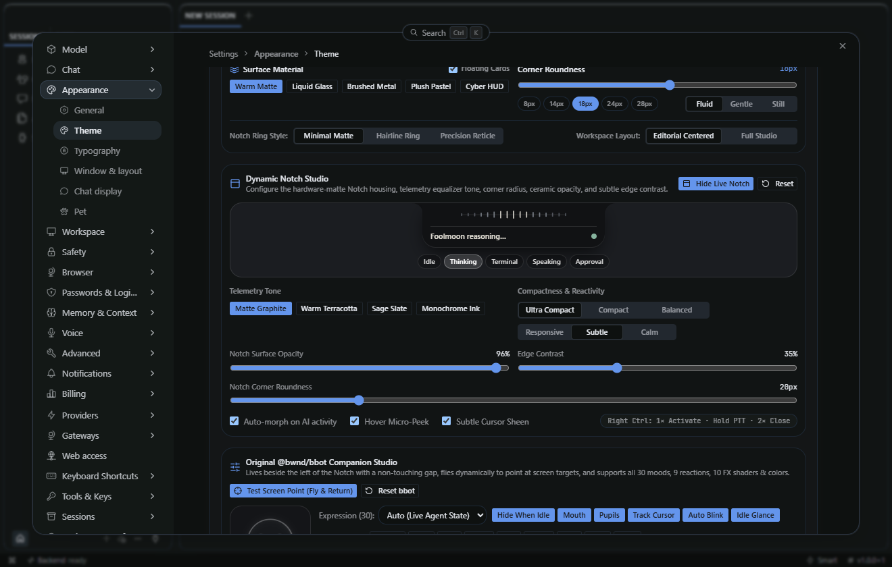
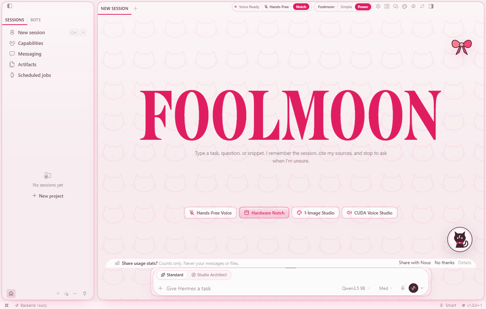
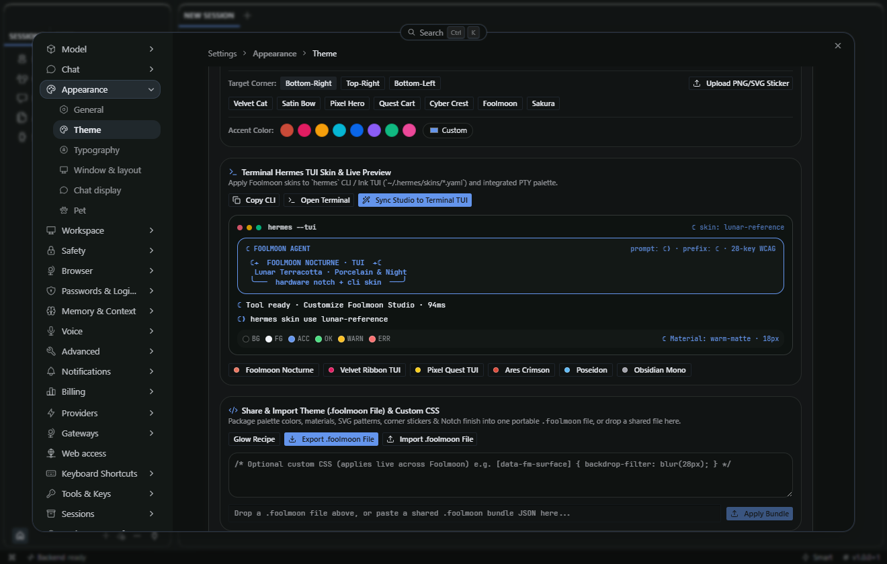
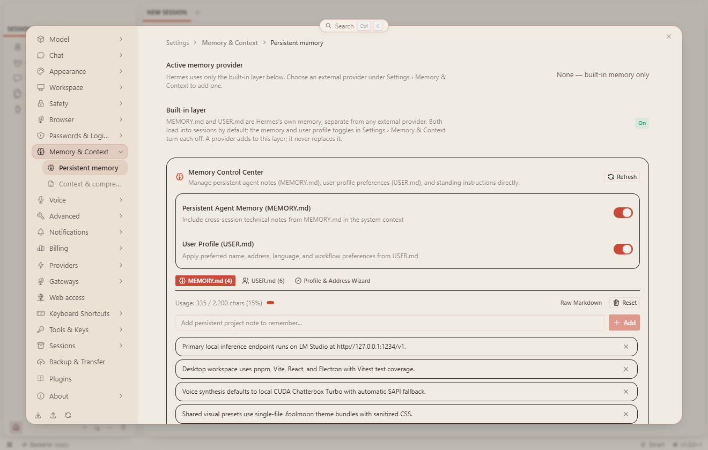
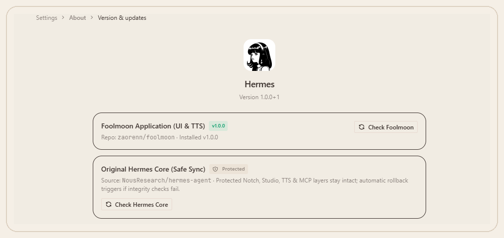
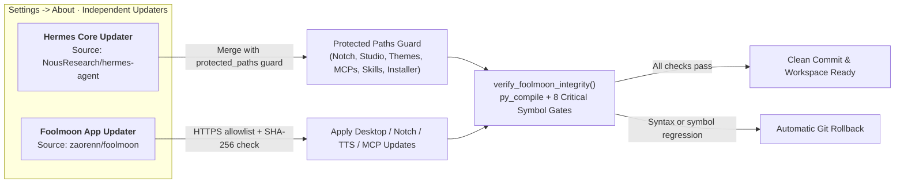

<div align="center">

# Foolmoon

**A native Windows desktop workspace and local-first studio layer built on top of [NousResearch/hermes-agent](https://github.com/NousResearch/hermes-agent).**  
Designed for zero-prerequisite Windows installation with local LLMs (LM Studio), non-breaking upstream Hermes Core syncs, a hardware-matte Dynamic Notch overlay, and portable single-file `.foolmoon` themes.

[](https://github.com/zaorenn/foolmoon/releases/latest)
[](https://github.com/zaorenn/foolmoon/releases/latest)
[](https://lmstudio.ai/)
[](#out-of-the-box-local-autonomy-6-zero-api-key-mcp-servers-44-tools)
[](https://github.com/NousResearch/hermes-agent)
[](LICENSE)

[**Download `Foolmoon-Setup.exe`**](https://github.com/zaorenn/foolmoon/releases/latest/download/Foolmoon-Setup.exe) · [**Why Foolmoon?**](#why-foolmoon-instead-of-vanilla-hermes-agent) · [**Visual Tour**](#in-app-visual-tour) · [**Dual Updates**](#dual-non-breaking-update-architecture) · [**1-Click Install**](#1-click-windows-install)

<br/>


</div>

---

## Why Foolmoon Instead of Vanilla Hermes Agent?

Upstream `hermes-agent` provides the core terminal agent, tool runtime, and gateway stack, while setting up a cohesive Windows desktop environment manually requires installing Python, Git, and Node runtimes, configuring local MCP servers, editing Markdown memory files on disk, and resolving merge conflicts whenever upstream updates arrive.

Foolmoon leaves the upstream Hermes runtime intact underneath and adds a self-contained desktop layer on top:

| Capability | Vanilla Hermes Agent | Foolmoon |
| :--- | :--- | :--- |
| **Clean-PC Windows Setup** | Manual Python, Git, Node.js, venv, and YAML wiring | **Single-file `Foolmoon-Setup.exe`** provisions PortableGit, `uv`, Python, and Node automatically on clean Windows 10/11 PCs with only LM Studio and a local model |
| **Global Hardware Overlay** | Terminal or focused window only | **Matte Architectural Dynamic Notch** (`Right Ctrl`: `1×` activate, `Hold` push-to-talk, `2×` dismiss) with a 17-bar precision equalizer, **Voice/1-Click Tool Approvals**, and **Clarify + File Drop** |
| **Screen Companion** | None | **Integrated `@bwnd/bbot` Companion** with 30 expressions, 9 motion reactions, 10 shader FX sliders, idle auto-hide, and **Screen Spotlight Callout** pointing to UI targets |
| **Workspace Density** | Fixed workspace view | Instant **`Simple` ↔ `Power` Mode** toggle — focused voice & writing surface vs. full session tree, Bots, Capabilities, Messaging, Artifacts, and embedded PTY |
| **Prompt & Tool Isolation** | Manual tool filtering | Strict **`Standard` vs. `Studio Architect`** isolation — `Standard` runs unmodified Hermes tools; `Studio Architect` exposes live visual/theme tools only when explicitly enabled |
| **Theming & Sharing** | Static YAML skins / light-dark toggle | **Visual, Material & Universe Studio** — 5 original presets, **1-Image Palette Extraction**, surface materials, SVG canvas tiles, corner stickers, **1-click Terminal TUI Sync**, and **single-file `.foolmoon` theme export/import** |
| **Local Speech & Fallback** | Cloud API keys or silent offline runs | **CUDA Zero-Shot Voice Cloning** (`chatterbox_turbo`, `chatterbox`, `xtts_v2`, `f5_tts`, `kokoro`), prosody tuning, karaoke timings, and **automatic offline Windows SAPI 24 kHz fallback** |
| **Memory & Profile UI** | Direct manual edits to `MEMORY.md` / `USER.md` | **Visual Memory Control Center** under `Settings → Memory & Context`: live layer toggles, structured `§` entry editor, raw Markdown mode, reset, and **Profile & Address Wizard** |
| **Bundled Local MCPs** | Empty MCP server list initially | **6 Zero-API-Key MCP Servers (44 tools)** + curated desktop/autonomy skills pre-seeded during install |
| **Upstream Merge Safety** | Raw pulls can overwrite UI or custom tools | **Dual Non-Breaking Updater** (`Settings → About`) updates **Foolmoon App** and **Original Hermes Core** separately behind `foolmoon-manifest.json`, symbol gates, and **automatic git rollback** |
| **Tray Persistence** | Closing the window stops active runs | **Minimize to System Tray** enabled by default on Windows so closing `X` preserves background tasks and unsaved session work |
| **Payload & Fetch Guards** | Standard CLI defaults | SSRF public-URL validation on web fetches, strict HTTPS GitHub allowlist + SHA-256 checks on updates, sanitized `.foolmoon` CSS/raster bundles, and `0o600` atomic memory writes |

---

## In-App Visual Tour

### 1. Matte Architectural Notch & Flying `@bwnd/bbot` Companion

Summon Foolmoon over any IDE, browser, or full-screen window without switching focus. Press **`Right Ctrl`** once to open the top bezel tray, approve or deny commands by voice (`"Approve"` / `"Deny"`) or single click, drop attachments onto the interactive clarify shelf, or send **`@bwnd/bbot`** out of the Notch to highlight specific controls on screen.

The Notch uses a low-glare graphite housing (`#111214` / `#141518`), precision hairline equalizer bars, restrained palette tones (`Matte Graphite`, `Warm Terracotta`, `Sage Slate`, `Monochrome Ink`), and high-contrast warm-ivory (`#F2EFE9`) primary action controls.

<div align="center">
  
</div>

<br/>

| `Right Ctrl` Gesture | Behavior |
| :--- | :--- |
| **Single Press (`1×`)** | Activates and expands the Dynamic Notch tray over the current application |
| **Press & Hold (`PTT`)** | Captures push-to-talk speech; releasing sends the transcribed command |
| **Double Press (`2×`)** | Collapses the tray back to the resting edge capsule |

Both the Dynamic Notch and `@bwnd/bbot` expose full live customization in **`Settings → Appearance → Theme`**:

<table>
  <tr>
    <td width="50%" align="center">
      
      <br/><sub><b>Dynamic Notch Studio</b> — Live preview stage, <code>Telemetry Tone</code> presets, compactness, opacity, <code>Edge Contrast</code>, corner radius, and ring finish (<code>Minimal Matte</code>, <code>Hairline Ring</code>, <code>Precision Reticle</code>).</sub>
    </td>
    <td width="50%" align="center">
      
      <br/><sub><b>@bwnd/bbot Companion Studio</b> — 30 expressions, 9 motion reactions, idle auto-hide, notch placement, and 10 real-time FX knobs (<code>Gloss</code> through <code>Hue</code>).</sub>
    </td>
  </tr>
</table>

---

### 2. Instant `Simple` ↔ `Power` Mode Switching

Switch workspace density in one click without restarting the backend or losing conversation state:

<table>
  <tr>
    <td width="50%" align="center">
      
      <br/><sub><b>Simple Mode</b> — Distraction-free canvas with an inline @bwnd/bbot voice bar, TTS playback toggle, Notch button, and hidden sidebar.</sub>
    </td>
    <td width="50%" align="center">
      
      <br/><sub><b>Power Mode</b> — Full session tree, project workspaces, Bots, Capabilities, Messaging, Artifacts, and Scheduled Jobs.</sub>
    </td>
  </tr>
</table>

---

### 3. Visual Studio, `Studio Architect` Isolation, `.foolmoon` Sharing & TUI Sync

Foolmoon separates everyday coding and writing tasks from desktop appearance automation:

- **`Standard` Mode**: Runs the unmodified upstream Hermes toolset. Coding, browser, and website-generation requests never alter desktop styles or presets.
- **`Studio Architect` Mode**: Unlocks `customize_foolmoon_studio` so natural-language requests or a single dropped reference image generate cohesive dark/light tokens, surface materials (`Warm Matte`, `Liquid Glass`, `Brushed Metal`, `Plush Pastel`, `Cyber HUD`), corner radii, tiled SVG patterns, and non-blocking corner stickers.

<div align="center">
  
</div>

<br/>

<table>
  <tr>
    <td width="50%" align="center">
      
      <br/><sub><b>Original Showcase Universes</b> — Original cohesive light &amp; dark themes with custom geometric vector charms (<code>Warm Studio Cream</code>, <code>Velvet Ribbon</code>, <code>RPG Pixel Quest</code>, <code>Obsidian Circuit</code>, <code>Lunar Frost Glass</code>).</sub>
    </td>
    <td width="50%" align="center">
      
      <br/><sub><b>Single-File <code>.foolmoon</code> Sharing &amp; Terminal TUI Sync</b> — Export and import complete themes (colors, materials, SVG patterns, raster corner stickers, custom CSS, and Notch finish) in one portable <code>.foolmoon</code> file, or sync straight to Hermes TUI.</sub>
    </td>
  </tr>
</table>

#### Portable `.foolmoon` Bundle Security

Shared themes export as self-contained JSON files using schema `foolmoon.theme.v1` with built-in import validation in [`foolmoon-theme-bundle.ts`](apps/desktop/src/themes/foolmoon-theme-bundle.ts):

- **Size & Token Bounds**: Enforces a **5 MB** bundle cap (`MAX_THEME_BUNDLE_BYTES`) and validates color values against hex/RGB/HSL formats.
- **CSS Sanitization**: Strips `<script>`, `<style>`, `@import`, `@charset`, `expression()`, `behavior:`, `-moz-binding`, `javascript:`/`vbscript:`, remote `http(s)://` URLs, and inline `data:image/svg+xml` payloads from imported custom CSS.
- **Raster-Only Custom Stickers**: Custom uploaded sticker images accept inline base64 raster formats only (`png`, `jpeg`, `jpg`, `webp`, `gif`) up to `2,800,000` characters, rejecting SVG scripts and external URLs.

---

### 4. Local CUDA Zero-Shot Voice Cloning & Offline SAPI Fallback

Run local speech synthesis on NVIDIA GPUs without third-party TTS API keys or per-character billing. Foolmoon integrates five local engines (`chatterbox_turbo`, `chatterbox`, `xtts_v2`, `f5_tts`, `kokoro`) with sample recording/upload, prosody sliders (`Exaggeration`, `CFG Weight`, `Temperature`, `Speed`), and word-boundary caption timing. When GPU synthesis or network `edge_tts` is unavailable, Foolmoon automatically falls back to **offline Windows SAPI 24 kHz PCM synthesis**.

<div align="center">
  
</div>

---

### 5. Visual Memory Control Center & Windows System Tray Protection

Manage agent persistence directly in **`Settings → Memory & Context`** without editing disk files manually:

<div align="center">
  
</div>

<br/>

<table>
  <tr>
    <td width="50%" valign="top">
      <h4>Memory Control Center (<code>MEMORY.md</code> &amp; <code>USER.md</code>)</h4>
      <ul>
        <li>Toggle persistent agent memory (<code>MEMORY.md</code>) and user profile injection (<code>USER.md</code>) independently</li>
        <li>Add, inspect, or delete structured <code>§</code> memory entries in-app</li>
        <li>Switch to Raw Markdown view for direct full-file edits, or reset safely</li>
        <li>Update name, preferred form of address, language, communication tone, role, and standing rules in the <b>Profile &amp; Address Wizard</b> using atomic <code>0o600</code> writes</li>
      </ul>
    </td>
    <td width="50%" valign="top">
      <h4>Windows System Tray Protection</h4>
      <ul>
        <li><b>Minimize to tray</b> is enabled by default on Windows so clicking close (<code>X</code>) moves Foolmoon cleanly into the notification area without interrupting active runs</li>
        <li>Double-click or right-click the tray icon to restore the workspace or quit explicitly</li>
        <li>Configurable under <b>Settings → Appearance → General</b></li>
      </ul>
    </td>
  </tr>
</table>

---

## Dual Non-Breaking Update Architecture

Foolmoon tracks **`zaorenn/foolmoon`** (desktop UI, Matte Notch, `@bwnd/bbot`, CUDA/SAPI voice layer, `.foolmoon` themes, bundled MCPs, skills, installer) separately from **`NousResearch/hermes-agent`** (core agent runtime, CLI, gateways) through [`foolmoon-manifest.json`](foolmoon-manifest.json):

<div align="center">
  
</div>

<br/>



---

## Out-of-the-Box Local Autonomy: 6 Zero-API-Key MCP Servers (44 Tools)

Clean installations automatically seed 6 local Python MCP servers via [`hermes_cli/bundled_mcps.py`](hermes_cli/bundled_mcps.py), active immediately with no external API keys:

| MCP Server | Tools | Provided Capabilities |
| :--- | :---: | :--- |
| **`windows_os`** | 10 | `list_windows`, `control_window`, `launch_app`, `system_volume`, `media_control`, `clipboard`, `keyboard_input`, `capture_screen`, `system_stats`, `notify_windows` |
| **`browser_pilot`** | 10 | `browser_open`, `browser_snapshot`, `browser_click`, `browser_type`, `browser_press_key`, `browser_scroll`, `youtube_play`, `browser_tabs`, `browser_screenshot`, `browser_eval_js` |
| **`power_files`** | 7 | `dir_overview`, `find_files`, `safe_trash`, `archive_manage`, `batch_organize`, `find_duplicates`, `inspect_document` |
| **`media_studio`** | 6 | `media_probe`, `video_edit`, `audio_edit`, `image_edit`, `images_to_pdf`, `extract_frames` |
| **`local_workbench`** | 6 | `sqlite_query`, `sqlite_schema`, `import_csv_to_sqlite`, `personal_vault`, `git_inspect`, `calculator_units` |
| **`web_power`** | 5 | `web_quick_search`, `fetch_webpage`, `http_api_request`, `download_file`, `fetch_rss_feed` |

<details>
<summary><b>Curated Bundled Skills Pre-Seeded on Install</b> (click to expand)</summary>

Foolmoon ships pre-configured skill directories protected in `foolmoon-manifest.json`:

- **Autonomy & Self-Skill Authoring**: `foolmoon-autonomy`, `self-skill-architect`, `screen-vision-pilot`, `computer-use`
- **Desktop & Local GPU**: `windows-power-automation`, `local-llm-gpu-tuner`
- **Live Web & Visualization**: `live-web-studio`, `data-viz-dashboard`, `architecture-diagram`, `study-flashcards-tutor`
- **Media & File Operations**: `ffmpeg-media-studio`, `browser-media-dj`, `file-organizer-cleaner`

</details>

---

## 1-Click Windows Install

### Option A — Clean Windows 10/11 Setup (`Foolmoon-Setup.exe`)

Built for fresh Windows systems with only **LM Studio and a local model** (or an OpenAI-compatible local server) present — no pre-installed Python, Git, or Node.js required.

1. Download **[`Foolmoon-Setup.exe`](https://github.com/zaorenn/foolmoon/releases/latest/download/Foolmoon-Setup.exe)** from [GitHub Releases](https://github.com/zaorenn/foolmoon/releases/latest) (optionally verify integrity against `SHA256SUMS.txt`).
2. Run `Foolmoon-Setup.exe` and complete the 4-step installer:
   - **Step 1 — System Check**: Checks GPU/RAM hardware and lets you pick install directory and Desktop / Start Menu shortcuts while staging pinned PortableGit + `uv` if missing.
   - **Step 2 — Profile & Aesthetics**: Sets your preferred name, address, language, response tone, initial universe preset (`Obsidian Circuit`, `Lunar Frost Glass`, `Warm Studio Cream`), and starter rules written straight to `USER.md`.
   - **Step 3 — Local LLM & LM Studio**: Probes `http://127.0.0.1:1234/v1`, lists loaded LM Studio models automatically, or accepts any OpenAI-compatible local endpoint.
   - **Step 4 — Install & Launch**: Clones Foolmoon (`zaorenn/foolmoon`) with upstream remote (`NousResearch/hermes-agent`), provisions `.venv` and desktop build dependencies, seeds the 6 bundled MCP servers + skills, and launches Foolmoon. Press **`Right Ctrl`** anytime to summon the Dynamic Notch.

### Option B — Build Installer Locally from Source

```powershell
git clone https://github.com/zaorenn/foolmoon.git
cd foolmoon
powershell -ExecutionPolicy Bypass -File .\installer\build-setup.ps1
```

The built binary is written to `installer\dist\Foolmoon-Setup.exe` with `--version` and `--self-test` verification flags.

---

## Security, Privacy & Attribution

- **Local-First Runtime**: Operates offline against LM Studio (`http://127.0.0.1:1234/v1`) and local CUDA / Windows SAPI speech synthesis.
- **Network & Release Validation**: `web_power` validates public HTTP(S) destinations before connecting, and update verification enforces allowlisted HTTPS GitHub URLs plus SHA-256 checksum comparison (`SHA256SUMS.txt`).
- **Private Data Isolation**: `.env`, `config.yaml`, tokens, and personal `USER.md` / `MEMORY.md` files live strictly in the user's local Hermes home directory (`%LOCALAPPDATA%\hermes` or `~/.hermes`) with `0o600` atomic writes and are excluded from git tracking.
- **License & Core Attribution**: Released under the [MIT License](LICENSE). Built on top of the core runtime, CLI, gateway, and agent architecture from **[Nous Research (`hermes-agent`)](https://github.com/NousResearch/hermes-agent)**.
