<div align="center">

# Foolmoon

**A native Windows desktop workspace and local-first autonomous studio built on top of [NousResearch/hermes-agent](https://github.com/NousResearch/hermes-agent).**  
Engineered for single-click Windows onboarding with local LLMs (LM Studio), non-breaking upstream Hermes Core updates, and an integrated desktop companion experience.

[](https://github.com/zaorenn/foolmoon/releases/latest)
[](https://github.com/zaorenn/foolmoon/releases/latest)
[](https://lmstudio.ai/)
[](#out-of-the-box-local-autonomy-6-zero-api-key-mcp-servers-44-tools)
[](https://github.com/NousResearch/hermes-agent)
[](LICENSE)

[**Download `Foolmoon-Setup.exe`**](https://github.com/zaorenn/foolmoon/releases/latest/download/Foolmoon-Setup.exe) · [**Why Foolmoon?**](#why-foolmoon-instead-of-vanilla-hermes-agent) · [**Visual Tour**](#in-app-visual-tour) · [**Dual Updates**](#dual-non-breaking-update-architecture) · [**1-Click Install**](#1-click-windows-install)

<br/>

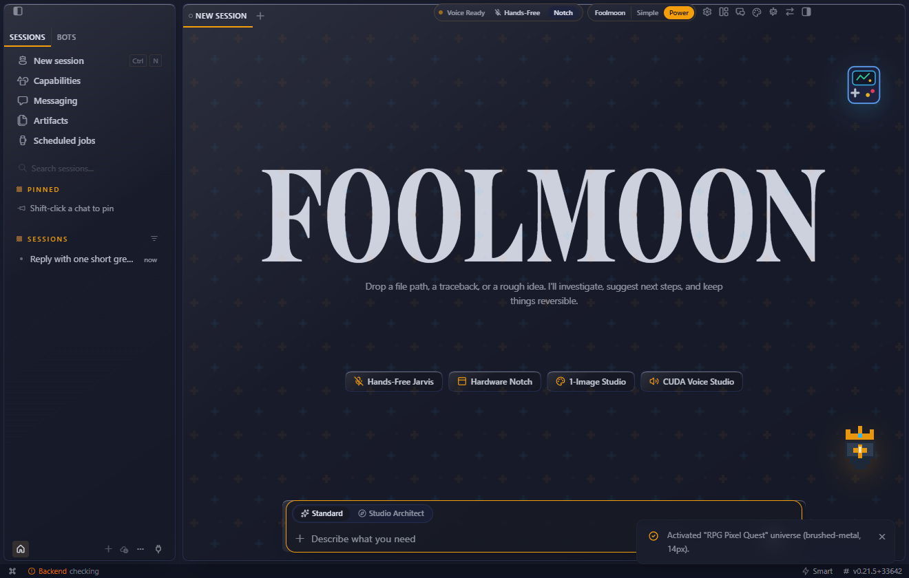

</div>

---

## Why Foolmoon Instead of Vanilla Hermes Agent?

Vanilla `hermes-agent` provides a capable terminal agent and API gateway, but getting a responsive Windows desktop workflow requires manual environment setup, custom MCP wiring, manual Markdown edits for memory, and careful merge conflict management when pulling upstream changes.

**Foolmoon** keeps original Hermes 100% intact underneath while adding a complete desktop layer on top:

| Capability | Vanilla Hermes Agent | Foolmoon |
| :--- | :--- | :--- |
| **Clean-PC Windows Setup** | Manual Python, Git, Node.js, venv, and YAML configuration | **Single-file `Foolmoon-Setup.exe`** installs on clean Windows 10/11 with only LM Studio + one local model loaded — no pre-installed runtimes needed |
| **Always-On Desktop Overlay** | Terminal or main window only | **Dynamic Hardware Notch** (`Right Ctrl`: `1×` activate, `Hold` push-to-talk, `2×` close) with live Aurora wave, **Voice/1-Click Tool Approvals**, and **Interactive Clarify + File Drop Shelf** |
| **Animated Screen Companion** | None | **Original `@bwnd/bbot` Companion** with 30 moods, 9 reactions, 10 shader FX sliders, idle auto-hide, and **Flying Screen Spotlight** pointing directly at UI targets |
| **Workspace Complexity Toggle** | Single layout | Instant **`Simple` ↔ `Power` Mode** switch — minimalist focus canvas vs. full multi-session workbench |
| **Mode & Prompt Isolation** | Manual prompt/tool filtering | Strict **`Standard` vs. `Studio Architect`** isolation — `Standard` runs pure upstream Hermes with zero theming tools; `Studio Architect` unlocks live workspace & TUI theming |
| **Theme & Visual Engine** | Static YAML skins / light-dark toggle | **Visual, Material & Universe Studio** — 5 one-click universes, **1-Image Palette Extraction**, surface materials, SVG canvas patterns, corner stickers, and **1-click Terminal TUI Skin Sync** |
| **Local Speech & Voice Cloning** | External TTS keys or silence offline | **CUDA Zero-Shot Voice Cloning** (`chatterbox_turbo`, `chatterbox`, `xtts_v2`, `f5_tts`, `kokoro`), live prosody tuning, word-level karaoke timings, and **automatic offline Windows SAPI 24 kHz fallback** |
| **Memory & Profile Control** | Edit `MEMORY.md` / `USER.md` manually on disk | **Direct Memory Control Center** inside `Settings → Memory & Context`: live `MEMORY.md` & `USER.md` toggles, `§` entry editor, raw Markdown editor, safe reset, and built-in **Profile & Address Wizard** |
| **Out-of-the-Box Local Tools** | Empty MCP server list until configured | **6 Zero-API-Key Bundled MCP Servers (44 native tools)** + curated skills pre-seeded on install |
| **Upstream Sync Safety** | Pulling upstream can overwrite local patches | **Dual Non-Breaking Update Engine** (`Settings → About`) updates **Foolmoon App** and **Original Hermes Core** independently, protected by `foolmoon-manifest.json`, symbol integrity checks, and **automatic rollback** |
| **Background Task Safety** | Closing main window terminates active turns | **Windows System Tray Protection** enabled by default — closing `X` minimizes safely to tray without interrupting running agents |
| **Release & Network Security** | Standard CLI defaults | SSRF public-URL checks on remote HTTP fetches, strict HTTPS GitHub allowlist + SHA-256 verification on app updates, CSS sanitization, and `0o600` atomic memory writes |

---

## In-App Visual Tour

### 1. Dynamic Hardware Notch & Flying `@bwnd/bbot` Companion

Summon Foolmoon from inside any fullscreen app, IDE, or browser without switching windows. Press **`Right Ctrl`** once to expand the top overlay, approve elevated commands hands-free by voice (`"Onayla"` / `"Reddet"`), drop files directly onto the clarify shelf, or have **`@bwnd/bbot`** fly out of the Notch to spotlight UI targets across your monitor.

<div align="center">
  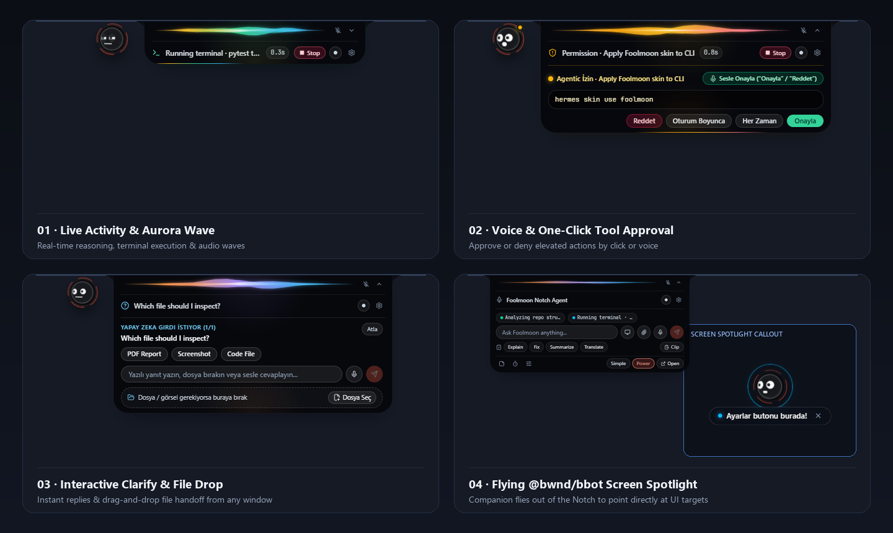
</div>

<br/>

| `Right Ctrl` Gesture | Action |
| :--- | :--- |
| **Single Press (`1×`)** | Activates and expands the Dynamic Notch tray immediately from any application |
| **Press & Hold (`PTT`)** | Starts push-to-talk speech capture; release to send voice command directly |
| **Double Press (`2×`)** | Dismisses the active tray back into compact resting state |

Both the Dynamic Notch and `@bwnd/bbot` expose granular visual controls in **`Settings → Appearance → Theme`**:

<table>
  <tr>
    <td width="50%" align="center">
      
      <br/><sub><b>Dynamic Notch Studio</b> — Live Aurora palettes (<code>Aurora Sunset</code>, <code>Emerald Pulse</code>, <code>Cyber Violet</code>, <code>Monochrome Frost</code>), opacity, rim glow, roundness, and cursor micro-peek.</sub>
    </td>
    <td width="50%" align="center">
      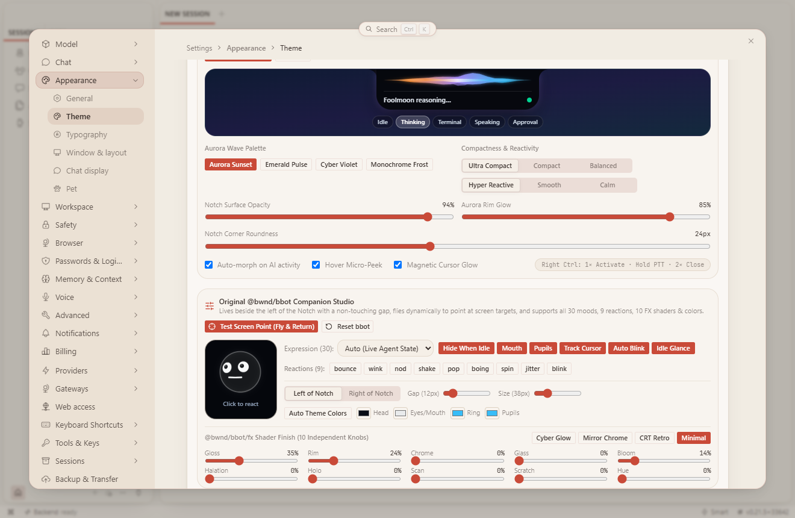
      <br/><sub><b>@bwnd/bbot Companion Studio</b> — 30 live expressions, 9 physics reactions, idle auto-hide, cursor tracking, and 10 real-time FX shader sliders (<code>Gloss</code> through <code>Hue</code>).</sub>
    </td>
  </tr>
</table>

---

### 2. Instant `Simple` ↔ `Power` Mode Switching

Switch workspace density in one click without restarting your session or losing context:

<table>
  <tr>
    <td width="50%" align="center">
      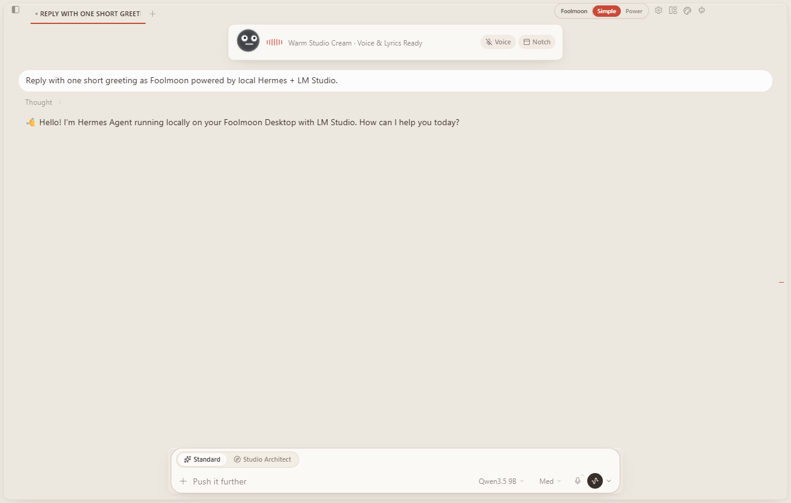
      <br/><sub><b>Simple Mode</b> — Minimal editorial canvas with a compact @bwnd/bbot voice bar, TTS playback controls, Notch shortcut, and zero sidebar clutter.</sub>
    </td>
    <td width="50%" align="center">
      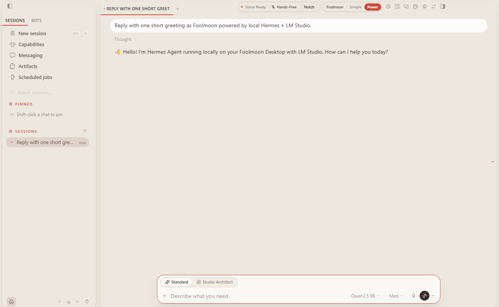
      <br/><sub><b>Power Mode</b> — Full session tree, pinned threads, Bots, Capabilities, Messaging, Artifacts, Scheduled Jobs, and embedded PTY tools.</sub>
    </td>
  </tr>
</table>

---

### 3. Visual, Material & 1-Image Theme Studio (`Studio Architect` Isolation)

Foolmoon enforces **strict tool isolation** between coding tasks and visual workspace customization:

- **`Standard` Mode**: Runs the unmodified upstream Hermes toolset (`standard` composer pill). No appearance or studio styling tools are injected, ensuring coding, research, or website-building requests never touch your desktop theme.
- **`Studio Architect` Mode**: Exposes `customize_foolmoon_studio` so natural-language prompts or single reference images transform surface materials (`Warm Matte`, `Liquid Glass`, `Brushed Metal`, `Plush Pastel`, `Cyber HUD`), corner geometry, SVG canvas patterns, and corner character charms in milliseconds.

<div align="center">
  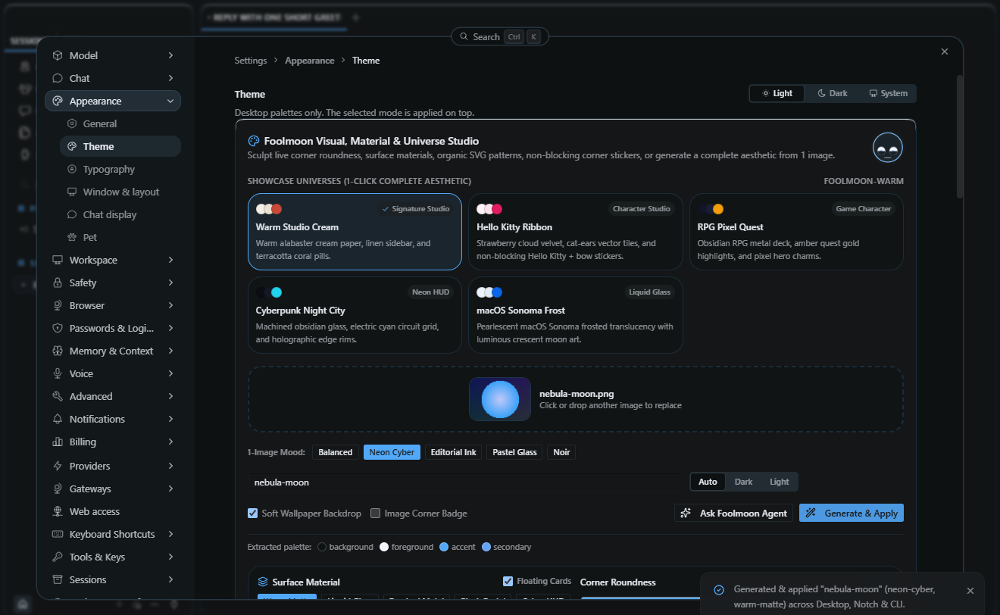
</div>

<br/>

<table>
  <tr>
    <td width="50%" align="center">
      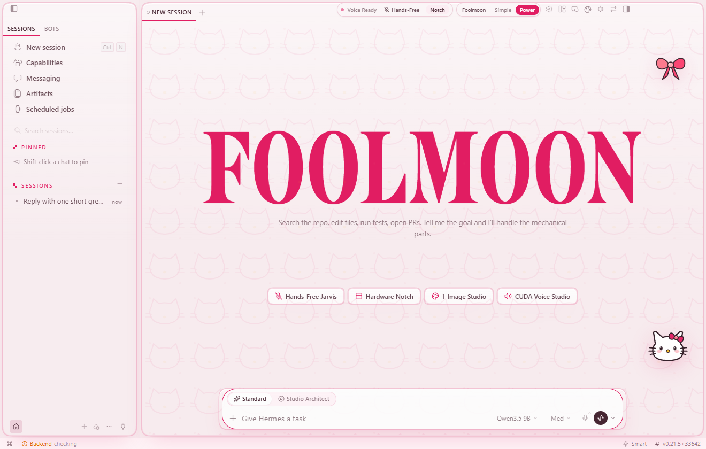
      <br/><sub><b>One-Click Showcase Universes</b> — Complete light & dark aesthetics with SVG canvas tiling and non-blocking corner stickers (<code>Hello Kitty Ribbon</code>, <code>RPG Pixel Quest</code>, <code>Cyberpunk Night City</code>, <code>Warm Studio Cream</code>, <code>macOS Sonoma Frost</code>).</sub>
    </td>
    <td width="50%" align="center">
      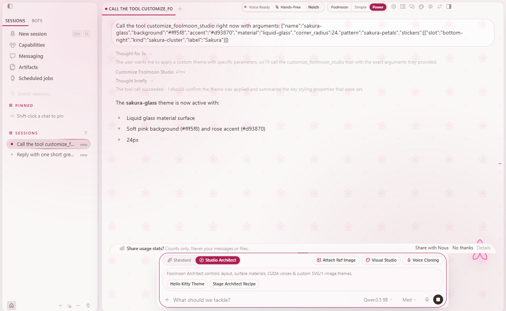
      <br/><sub><b>Live Studio Architect Execution</b> — Custom <code>sakura-glass</code> surface material, palette tokens, corner radius, SVG pattern, and charm applied live in 47 ms.</sub>
    </td>
  </tr>
</table>

Every saved visual preset can also be synchronized straight into your Hermes CLI / Ink terminal skin in one click:

<div align="center">
  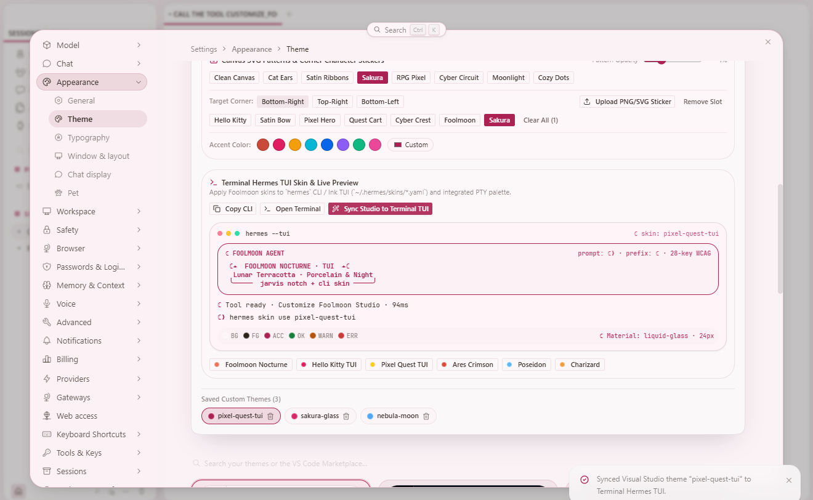
</div>

---

### 4. Local CUDA Zero-Shot Voice Cloning & Offline SAPI Fallback

Generate natural local speech on NVIDIA GPUs without paying per-character API fees or sending voice audio to third-party servers. Five CUDA engines (`chatterbox_turbo`, `chatterbox`, `xtts_v2`, `f5_tts`, `kokoro`) run alongside prosody controls (`Exaggeration`, `CFG Weight`, `Temperature`, `Speed`), reference voice recording/upload, and word-level karaoke timings. If GPU TTS or cloud `edge_tts` is unavailable, Foolmoon automatically falls back to **offline Windows SAPI 24 kHz PCM synthesis** so spoken replies never fail silently.

<div align="center">
  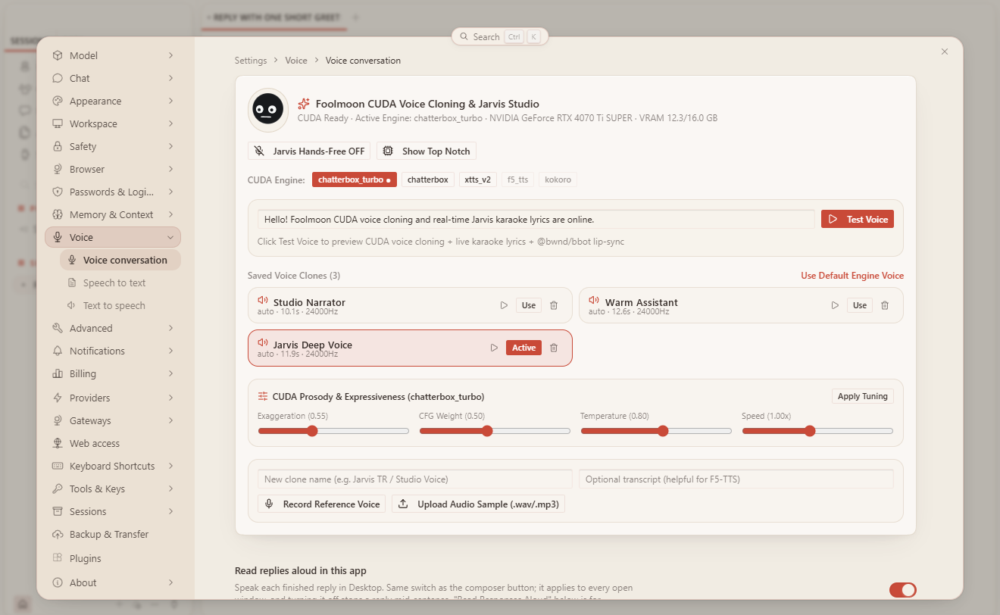
</div>

---

### 5. Direct Memory Control Center & Windows System Tray Protection

<table>
  <tr>
    <td width="50%" valign="top">
      <h4>Memory &amp; User Profile Control Center</h4>
      Open <b>Settings → Memory &amp; Context</b> to manage agent persistence directly in the UI without touching disk paths:
      <ul>
        <li>Enable or disable <code>MEMORY.md</code> and <code>USER.md</code> injection independently</li>
        <li>Inspect, add, or remove individual <code>§</code> memory entries in structured view</li>
        <li>Switch to raw Markdown mode for direct full-file editing</li>
        <li>Re-run the built-in <b>Hitap &amp; Profile Wizard</b> (preferred name, form of address, language, tone, persistent rules) with atomic <code>0o600</code> writes and prompt-injection screening</li>
      </ul>
    </td>
    <td width="50%" valign="top">
      <h4>Windows System Tray Protection</h4>
      Unlike standard desktop wrappers that terminate background agents on window close, Foolmoon enables <b>Minimize to tray</b> by default on Windows:
      <ul>
        <li>Clicking the window close button (<code>X</code>) minimizes cleanly to the Windows notification tray instead of killing active turns or losing unsaved state</li>
        <li>Right-click the tray icon anytime to restore the workspace or explicitly quit</li>
        <li>Configurable under <b>Settings → Appearance → General</b></li>
      </ul>
    </td>
  </tr>
</table>

---

## Dual Non-Breaking Update Architecture

Most forks break custom features whenever upstream moves forward. Foolmoon separates **`zaorenn/foolmoon`** (desktop UI, Notch, `@bwnd/bbot`, CUDA/SAPI TTS, bundled MCPs, skills, installer) from **`NousResearch/hermes-agent`** (core agent runtime, CLI, gateways) using [`foolmoon-manifest.json`](foolmoon-manifest.json):

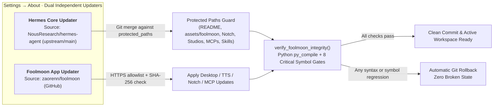

- **Update Foolmoon App** independently to get UI, Notch, `@bwnd/bbot`, TTS, and MCP improvements.
- **Update Original Hermes Core** independently whenever Nous Research ships upstream runtime upgrades — if a merge ever breaks a core hook or protected path, Foolmoon rolls back automatically and leaves your workspace working.

---

## Out-of-the-Box Local Autonomy: 6 Zero-API-Key MCP Servers (44 Tools)

Every clean Foolmoon installation automatically seeds 6 local Python MCP servers via [`hermes_cli/bundled_mcps.py`](hermes_cli/bundled_mcps.py) — ready on first launch with zero external API keys required:

| MCP Server | Tools | Key Capabilities |
| :--- | :---: | :--- |
| **`windows_os`** | 10 | `list_windows`, `control_window`, `launch_app`, `system_volume`, `media_control`, `clipboard`, `keyboard_input`, `capture_screen`, `system_stats`, `notify_windows` |
| **`browser_pilot`** | 10 | `browser_open`, `browser_snapshot`, `browser_click`, `browser_type`, `browser_press_key`, `browser_scroll`, `youtube_play`, `browser_tabs`, `browser_screenshot`, `browser_eval_js` |
| **`power_files`** | 7 | `dir_overview`, `find_files`, `safe_trash`, `archive_manage`, `batch_organize`, `find_duplicates`, `inspect_document` |
| **`media_studio`** | 6 | `media_probe`, `video_edit`, `audio_edit`, `image_edit`, `images_to_pdf`, `extract_frames` |
| **`local_workbench`** | 6 | `sqlite_query`, `sqlite_schema`, `import_csv_to_sqlite`, `personal_vault`, `git_inspect`, `calculator_units` |
| **`web_power`** | 5 | `web_quick_search`, `fetch_webpage`, `http_api_request`, `download_file`, `fetch_rss_feed` |

<details>
<summary><b>Curated Bundled Skills Pre-Seeded on Install</b> (click to expand)</summary>

Foolmoon includes specialized autonomy, desktop control, creative HTML/data preview, media processing, and local GPU optimization skills protected inside `foolmoon-manifest.json`:

- **Autonomy & Self-Skill Authoring**: `foolmoon-autonomy`, `self-skill-architect`, `screen-vision-pilot`, `computer-use`
- **Desktop & Local GPU**: `windows-power-automation`, `local-llm-gpu-tuner`
- **Live Web & Visualization**: `live-web-studio`, `data-viz-dashboard`, `architecture-diagram`, `study-flashcards-tutor`
- **Media & File Operations**: `ffmpeg-media-studio`, `browser-media-dj`, `file-organizer-cleaner`

</details>

---

## 1-Click Windows Install

### Option A — Clean Windows 10/11 Setup (`Foolmoon-Setup.exe`)

Designed for fresh Windows PCs that have **only LM Studio and a local model** (or an OpenAI-compatible API endpoint) installed — no pre-installed Python, Git, or Node.js needed.

1. Download **[`Foolmoon-Setup.exe`](https://github.com/zaorenn/foolmoon/releases/latest/download/Foolmoon-Setup.exe)** from [GitHub Releases](https://github.com/zaorenn/foolmoon/releases/latest).
2. Double-click `Foolmoon-Setup.exe` and step through the 4-screen setup wizard:
   - **Welcome & System Check** — Detects LM Studio (`http://127.0.0.1:1234/v1`) and loaded models automatically, plus provisions missing Python/Git/Node runtimes silently via `winget` / official standalone archives.
   - **Personalization & Rules** — Configure your preferred name, form of address, language, response tone, and permanent rules saved directly into `USER.md`.
   - **Runtime Installation** — Clones/syncs Foolmoon, builds `.venv` and desktop dependencies, syncs bundled MCPs and skills, and creates Start Menu + Desktop shortcuts.
   - **Launch** — Open Foolmoon and press **`Right Ctrl`** anytime to summon the Dynamic Notch.

### Option B — Build Installer Locally from Source

```powershell
git clone https://github.com/zaorenn/foolmoon.git
cd foolmoon
powershell -ExecutionPolicy Bypass -File .\installer\build-setup.ps1
```

---

## Security, Privacy & Attribution

- **Local-First by Default**: Works completely offline against local LM Studio models (`http://127.0.0.1:1234/v1`) and offline Windows SAPI / local CUDA TTS.
- **SSRF & Release Integrity Guards**: `web_power` and theme/API fetch paths validate public HTTP(S) destinations (`validate_public_http_url`), and updater installers validate official HTTPS GitHub release URLs plus SHA-256 digests (`SHA256SUMS.txt`).
- **Private Config Isolation**: `.env`, `config.yaml`, credentials, and personal `USER.md` / `MEMORY.md` data stay strictly inside the local user home directory with `0o600` atomic writes and are never tracked in git.
- **License & Core Attribution**: Released under the [MIT License](LICENSE). Built on top of the upstream core runtime, CLI, gateway, and agent architecture by **[Nous Research (`hermes-agent`)](https://github.com/NousResearch/hermes-agent)**.
